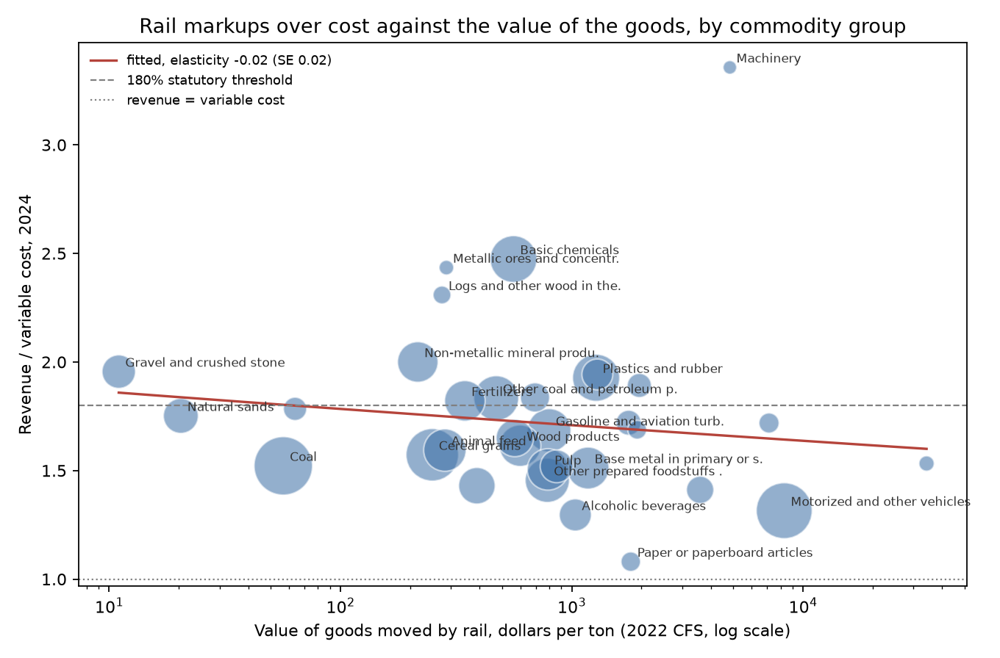
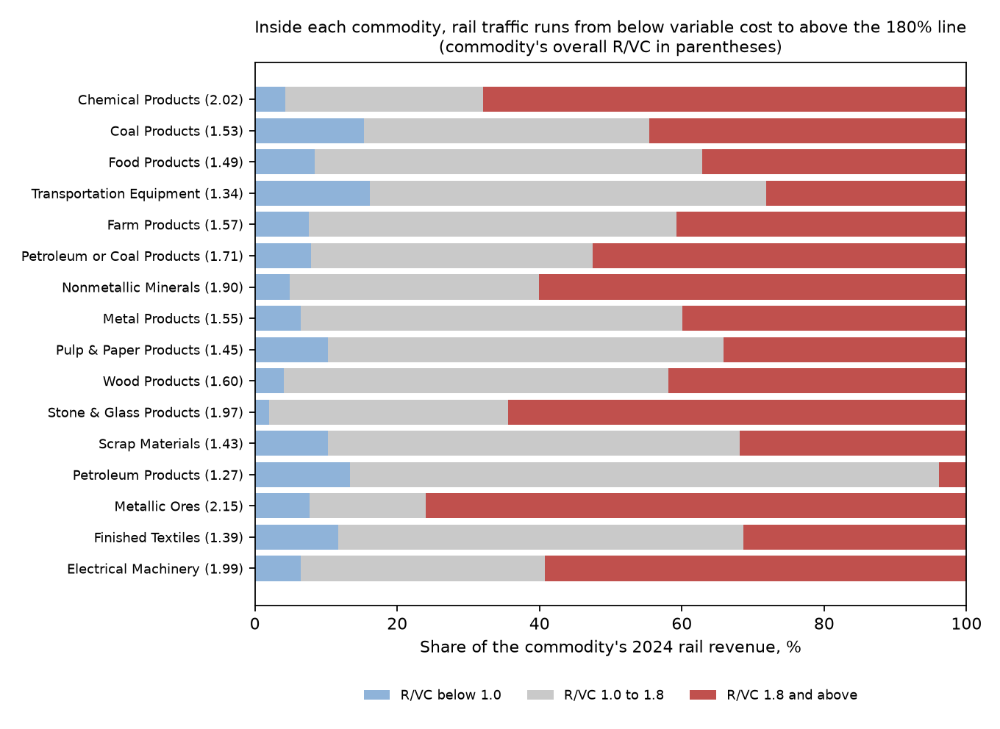

# What the Traffic Will Bear

### In 1920, Arthur Pigou sorted price discrimination into three degrees and said railways charge valuable goods more than cheap ones. A century later, I checked what American railroads actually charge.

---

A covered hopper car full of corn and a covered hopper car full of polyethylene pellets look almost the same from a
grade crossing. They may ride in the same train behind the same BNSF or Union Pacific locomotives. The cargo is not the same. A ton of the plastics that move by rail is worth about $1,275, according to
the Census Bureau's 2022 Commodity Flow Survey, while a ton of cereal grain is worth about $250. In 2024 the
railroads moved 80.5 million tons of corn an average of 1,195 miles and collected $3.26 billion for it. They moved
45.1 million tons of polyethylene an average of 613 miles and collected $1.47 billion.

The Surface Transportation Board, the federal regulator of freight railroads, publishes those figures every year,
commodity by commodity, alongside its own estimate of what each kind of traffic costs to carry. That makes rail
freight one of the few markets where an outsider can line up price against cost for hundreds of products at once,
and the natural place to test one of the oldest ideas in the economics of price discrimination. Arthur Pigou set it
out in 1920, and his recurring example was a railway charging a copper merchant more than a coal merchant to carry a
ton the same distance.

---

## Markup over cost, the railroad way

The Board measures how far a rate sits above cost with a single ratio. Revenue *R* is what the railroad collects for
a movement. Variable cost *VC* is the Board's estimate of the cost that moves with traffic (crews, fuel, locomotives,
car wear, track wear), computed with its Uniform Railroad Costing System.

```math
\text{R/VC} = \frac{R}{VC}
```

For corn in 2024 the two numbers were $3,255.8 million and $2,041.5 million.

```math
\text{R/VC}_{\text{corn}} = \frac{3{,}255.8}{2{,}041.5} = 1.59
```

So for every dollar of variable cost the railroads collected $1.59 from corn shippers. The 59 cents above cost is
not all profit. Track, bridges, signals and yards are paid for out of it, and a railroad that priced every movement
at variable cost would go broke.

The ratio has a legal threshold. Under federal law the Board cannot find that a railroad dominates a market, and so
cannot review whether its rate is reasonable, unless the rate is at least 180% of variable cost. Across the
commodity traffic in the Board's 2024 report, without mixed and empty shipments, the three zones look like this.

| R/VC zone | What it means | Share of 2024 rail revenue | Average R/VC in the zone |
|---|---|---|---|
| Below 1.0 | Revenue does not cover the variable cost | 8.7% | 0.78 |
| 1.0 to 1.8 | Covers cost, below the regulator's line | 44.3% | 1.38 |
| 1.8 and above | At or above the line for a rate complaint | 47.0% | 2.56 |

Revenue per ton-mile is the price of carrying one ton one mile. For corn it was 3.39 cents
against a variable cost of 2.12 cents. The freight share of value compares what a ton paid to move with what a ton
of the goods is worth.

```math
\text{freight share}_{\text{corn}} = \frac{\$40.47 \text{ per ton}}{\$249.62 \text{ per ton}} = 0.162
```

Polyethylene paid $32.54 a ton against goods worth $1,275, a freight share of 2.6%.

---

## Arthur Pigou's three degrees

Arthur Cecil Pigou was born in 1877 and was thirty when Cambridge appointed him to Alfred Marshall's chair of
political economy in 1908. He held the chair until 1943 and died in Cambridge in 1959. *Wealth and Welfare*
appeared in 1912 and its much larger successor, *The Economics of Welfare*, in 1920. That book is remembered mostly
for the argument that costs a business imposes on others, such as pollution, justify government action, which is
why taxes on them are still called Pigovian taxes. Its chapter on "Discriminating Monopoly" (chapter XIV in the
first edition, XVII in the fourth of 1932) gave economists the vocabulary they still use for price discrimination.

Pigou distinguished three degrees. In the first, the seller charges every unit exactly what the buyer would pay for
it and leaves the buyer nothing. In the second, it sets a ladder of prices and lets each unit fall to the step its
buyer will pay. In the third, it sorts customers into groups "separated from one another more or less by some
practicable mark" and charges each group its own monopoly price. His illustration of the first degree is in
shillings. A seller facing a buyer who would pay one shilling for a hundredth unit, but 300 shillings rather
than go without all hundred, can simply sell the hundred as one bundle for 300 shillings. Pigou called the method
"of academic interest only," because individual buyers are too different. He thought separate bargaining with every
customer was ruled out by its "enormous cost and trouble" and its openness to bribery, and he concluded that in real
life "the third degree only is found."

The next chapter applied all this to railway rates. Pigou set two principles against each other. Under the "cost of
service principle," which he identified with competition, every ton-mile would be sold at the same price, apart from
real differences in cost. Under the "value of service principle," which he identified with discrimination of the
third degree, railways sort freight into classes and charge each what it will bear. He argued that the classes
would be drawn mainly by the value of the goods. A shipper's willingness to pay for carriage from A to B is the gap
between the price of the goods at B and at A, and that gap is larger in dollars for valuable goods, "just as the
probable difference in the heights of poplars in A and B is greater than the probable difference in the heights of
cabbages." He noted that British railway classifications and American regulators' decisions both ranked goods by
value.

A footnote in the railway chapter works out the case of straight-line demand and constant cost, which shows what
the value principle predicts. Suppose class *i* of freight faces demand $`p_i = a_i - b_i q_i`$, where $`a_i`$ is
the most any shipper in the class would pay, and the railroad's cost per unit is a constant *c*. Pigou's poplars argument makes the top willingness to pay proportional
to the value of the goods, $`a_i = \kappa v_i`$, with $`\kappa > 0`$. Write $`m_i = p_i / c`$ for the R/VC of class *i*.

```math
\begin{aligned}
\max_{q_i}\ (a_i - b_i q_i - c)\,q_i \;&\Rightarrow\; q_i = \frac{a_i - c}{2 b_i}, \qquad p_i = \frac{a_i + c}{2} \\
m_i = \frac{p_i}{c} &= \frac{\kappa v_i + c}{2c} \\
\frac{d \ln m_i}{d \ln v_i} &= \frac{\kappa v_i}{\kappa v_i + c} = 1 - \frac{1}{2 m_i} \;\in\; (0, 1)
\end{aligned}
```

The first line is Pigou's footnote, that the monopoly markup is half the gap between cost and the top of the demand
curve. The last line says that under the value principle the markup over cost rises with the value of the goods. At
the 2024 average R/VC of 1.61, each 1% of extra value should raise R/VC by 0.69%. Under the cost principle the
elasticity is zero. Pigou's appendix adds that with straight-line demands this kind of discrimination sells the
same total output as a single price whenever both markets are served.

The strongest objection came from Frank Taussig of Harvard, who had argued in 1891 that railway rates differ
because the services are produced jointly, so that different prices are what competition itself would produce, as
with a pound of beef and a pound of hides. Pigou and Taussig argued it out in the *Quarterly Journal of Economics*
in 1913. Pigou's reply, repeated in the book, was that carrying coal and carrying copper over the same line are not
joint products at all, and that the analysis of discriminating monopoly covers every case joint supply can explain
and many it cannot. Since the Staggers Act of 1980, railroads and shippers have been free to sign confidential
contracts, and the 180% line is the modern legal boundary between differential
pricing the law accepts and pricing a shipper can challenge.

---

## How I tested it

The rates come from the Board's Commodity Revenue Stratification Report for 2024, which lists revenue, variable cost,
tons, cars and average miles for every 7-digit commodity code and car type the Board can release without exposing a
single shipper. The released cells cover $68.2 billion of the $79.4 billion of revenue in the report. I set aside
$12.9 billion of traffic that has no commodity identity, such as mixed intermodal containers, returned empty
trailers and freight-forwarder loads. That leaves 1,438 commodity-by-car-type cells with $55.3 billion of revenue
and an overall R/VC of 1.61.

The value of the goods comes from the 2022 Commodity Flow Survey, which reports the dollar value and tonnage of rail
shipments in 41 commodity groups. Rail freight is classified by one coding system and the survey by another, so I
built a crosswalk by hand from each rail code to the matching survey group, committed as a table in `data/`. Where
the survey suppresses rail figures for a group I use its all-mode value per ton and flag it. I used the Board's
report rather than the public file of individual waybills because the file's guide warns that railroads may disguise
contract revenue, and its expanded revenue is $101.2 billion, 27.5% more than the Board's report. Among groups with
more than $1 billion of revenue the gap runs from 13% for farm products to 37% for transportation equipment.

The main test regresses the markup on value across commodity groups *g*.

```math
\ln \text{R/VC}_g = \alpha + \beta \ln v_g + \varepsilon_g, \qquad H_0^{\text{cost}}: \beta = 0, \qquad H^{\text{value}}: 0 < \beta < 1
```

Here $`v_g`$ is the survey's value per ton. I estimate it with equal weights and with revenue weights, with
heteroskedasticity-robust (HC1) standard errors. A second version works at the level of the cells, so that a grain
car is compared with a plastics car of the same type.

```math
\ln \text{R/VC}_{c} = \beta \ln v_{g(c)} + \gamma \ln \text{miles}_c + \delta \ln \text{tons per car}_c + \mu_{k(c)} + \varepsilon_c
```

Here *c* is a commodity-by-car-type cell, *g(c)* its commodity group, and $`\mu_k`$ a fixed effect for each of the 16
equipment groups (covered hoppers, tank cars, gondolas and so on). Standard errors are clustered by commodity
group, the level at which value varies.

---

## Valuable goods do not carry the markups Pigou predicted

Across commodity groups, the value of the goods does nothing for the markup. Over 33 groups the estimated elasticity
is slightly negative.

```math
\hat{\beta} = -0.019 \;(0.021), \quad 95\%\ \text{CI}\ [-0.060,\ 0.022], \quad N = 33
```

Pigou's straight-line case predicts about 0.69. The confidence interval rules out anything above 0.022. Weighting by
revenue gives −0.028 (0.028), using only groups where the survey publishes rail values gives −0.004 (0.030), and
dropping coal and motor vehicles, the two largest groups, gives −0.017 (0.022).



Named commodities show the same thing.

| Commodity | R/VC, 2024 | Cents per ton-mile | Average haul, miles | Value of the group's goods, $ per ton |
|---|---|---|---|---|
| Metallurgical coal | 2.89 | 7.1 | 443 | 57 |
| PVC resin | 2.20 | 6.6 | 675 | 1,275 |
| Crushed limestone | 1.99 | 5.6 | 236 | 11 |
| Portland cement | 1.98 | 6.0 | 502 | 216 |
| Polyethylene pellets | 1.82 | 5.3 | 613 | 1,275 |
| Frac sand | 1.70 | 4.0 | 587 | 20 |
| Ethanol | 1.70 | 4.5 | 1,009 | 800 |
| Corn | 1.59 | 3.4 | 1,195 | 250 |
| Lumber | 1.54 | 4.6 | 1,423 | 598 |
| Thermal coal | 1.37 | 2.3 | 776 | 57 |
| Beer | 1.36 | 4.8 | 1,463 | 1,037 |
| New passenger cars | 1.23 | 15.4 | 1,132 | 8,298 |

Crushed limestone, worth $11 a ton, carries almost the same markup as Portland cement and a higher one than beer,
which is worth about a hundred times as much. New cars, the most valuable freight on the list, carry the lowest
markup. The survey's value figures are group averages, so metallurgical and thermal coal share one, yet their
markups are 2.89 and 1.37.

Within the same kind of equipment a faint trace of Pigou's gradient appears. Holding the car group, length of haul
and load fixed, the cell-level elasticity is 0.047 (0.024) with revenue weights, 95% CI [0.000, 0.094], across 1,434
cells in 33 clusters, and 0.087 (0.019) with equal weights. Doubling the value of the goods raises R/VC by about 3%
to 6%, far short of the 0.69 elasticity the straight-line case predicts. Inside covered hoppers the estimate is
0.046 (p = 0.055), and inside tank cars it is −0.135 (p = 0.085).

---

## Valuable goods pay more per ton, and their cost accounts for all of it

Pigou's prediction had a second half. He expected the freight charge to be larger in dollars for valuable goods but
not larger as a percentage of their value. That part holds. Across commodity groups, revenue per ton rises with
value with an elasticity of 0.35 (0.07), and the freight share of value falls with an elasticity of −0.65 (0.07).
Corn pays 16.2% of its value to move and polyethylene 2.6%.

The extra dollars come from cost. Valuable goods are bulkier for their weight, so a car holds fewer tons of them.
Across groups, tons per car fall with value at an elasticity of −0.38 (0.08). A rack car of new passenger cars
carries 21 tons, against 107 tons in a hopper of corn, and its variable cost is 12.6 cents per ton-mile against
2.1 for corn. Putting the Board's cost per ton-mile next to value settles which one matters.

```math
\ln \frac{R}{\text{ton-mile}} = \alpha + \underset{(0.019)}{-0.054}\,\ln v_g + \underset{(0.121)}{1.184}\,\ln \frac{VC}{\text{ton-mile}}, \qquad N = 33
```

A 1% higher cost per ton-mile goes with a 1.18% higher price per ton-mile, and once cost is held fixed, value has a
small negative coefficient. The pattern Pigou saw in the rate books of 1920, valuable goods paying more per ton,
survives in 2024, and in these data cost explains all of it.

---

## Depending on the railroad does not raise the markup either

Pigou's discrimination needs "non-transferability," customers who cannot take their business elsewhere. For freight
the elsewhere is a truck, a barge or a pipeline. A natural guess is that the commodities most dependent on rail
carry the highest markups. I measured dependence as rail's share of each group's 2022 shipment tonnage in the
Commodity Flow Survey, which runs from under 1% for textiles to 57% for coal.

| Test, per 10 points of rail's tonnage share | Effect on ln R/VC | Standard error | Groups |
|---|---|---|---|
| Alone, equal weights | −0.005 | 0.033 | 28 |
| With value, equal weights | −0.010 | 0.025 | 28 |
| With value, revenue weights | −0.037 | 0.017 | 28 |
| With value, without coal | +0.034 | 0.063 | 27 |
| Cells, with value and car-group fixed effects | +0.022 | 0.020 | 1,363 cells |

None of these is a positive and significant effect. The one significant estimate is negative and uses revenue
weights, which give the most weight to coal, the largest group by revenue. Coal depends heavily on rail and carries a below-average markup of 1.52,
because most of its revenue is thermal coal. High rates also
push traffic to trucks, lowering rail's share where markups are high, so these estimates lean downward and cannot
rule out a modest positive effect.

---

## Most of the price differences live inside each commodity

If railroads priced the way Pigou described, sorting freight into classes and charging each class its rate, most of
the spread in markups would lie between commodities. The Board's report allows a direct check, because it splits
every commodity's revenue into the three R/VC zones. Every one of the 12 commodity groups with more than $1 billion of
revenue has traffic in all three zones. The share priced below variable cost runs from 2.0% to 16.1%, and the share
at 1.8 or above from 28.1% to 68.0%. Coal is the clearest case. In 2024, 15.3% of its revenue came from traffic at an
average R/VC of 0.80 and 44.5% from traffic at an average of 2.72.



To put a number on it, I split the revenue-weighted variance of ln R/VC across 1,280 released commodity, car-type
and zone cells covering $63.6 billion of revenue. With $`y_j`$ the log markup of cell *j*, $`w_j`$ its revenue
share and $`\hat{y}_j^{(L)}`$ its fitted value from fixed effects at layer *L*, the share explained by each layer is

```math
R^2_L = 1 - \frac{\sum_j w_j \left(y_j - \hat{y}_j^{(L)}\right)^2}{\sum_j w_j \left(y_j - \bar{y}\right)^2}
```

| What the markup is allowed to depend on | Share of the variance explained |
|---|---|
| Value per ton of the goods | 1.6% |
| Commodity group (39 groups) | 16.4% |
| Detailed commodity (367 commodities) | 32.3% |
| Detailed commodity and car type | 35.2% |
| Left over, between zones within the same commodity and car type | 64.8% |

Each zone is itself an average over many shipments, so the true spread inside commodities is larger still and the
commodity shares are upper bounds. The remaining 64.8%
sits between shipments of the same goods in the same kind of car. Part of that is cost the Board's system-average
costing misses. Much of it is what a contract regime would produce, with rates set route by route and shipper by
shipper. The reference guide to the Board's waybill sample estimates that about two-thirds of sampled waybills use
the confidentiality mechanism for contract rates. Pigou ruled out separate bargaining with each customer as too
costly and too easily corrupted, yet the pattern in these data is closer to it than to a schedule of commodity
classes.

---

## Why it matters

For shippers, the markup on rail service depends far more on the particular movement than on the commodity. A
grain elevator and a chemical plant can each be paying well below or well above the 180% line.

For consumers, rail rates are a small part of what most finished products cost and a large part of what bulk goods
cost. Rail charges came to about 16% of the value of grain moved and more than the value of the goods themselves
for crushed stone and frac sand, so they show up in feed, fuel and building costs.

For smaller shippers, pricing by negotiation favors those with the volume, the lawyers and the alternatives to
bargain. A plant served by one railroad, with no barge dock and no practical truck route, has little to bargain
with, and its main formal recourse is a rate case at the Board.

For policy, the 180% line treats markups as a property of a movement, not of a commodity, and these data support
that choice. Rules written around commodity classes, the way 1920s regulators thought about rates, would miss most
of the variation that exists.

---

## Limits of this study

The Board's variable costs come from a system-wide costing model, not from the cost of any particular train, so some
of the spread in R/VC is error in cost rather than difference in price. The released report suppresses small cells,
and the commodities that survive are the large ones. Value per ton comes from a different survey, in a different
classification, two years earlier, and my crosswalk between the two systems is a judgment at several points, such as
assigning ethanol to fuels and soybean meal to animal feed. Value is measured for 33 broad groups, so differences in
value inside a group, such as metallurgical against thermal coal, are invisible to the main test. Rail's share of
tonnage is only a rough gauge of a shipper's alternatives, and it responds to rail prices. The Board's report does
not say whether it uses disguised or true contract revenue, and the gap against the public file suggests it uses
something closer to the truth, but I cannot confirm that. None of this shows that railroads lack market power,
only that their markups do not line up with the value of the goods.

---

## Further reading

- [TECHNICAL.md](TECHNICAL.md), with the data files, rules, every test statistic and how to reproduce the results.
- [results/FINDINGS.md](results/FINDINGS.md), with a plain-English summary and every table the scripts produce.
- [METHODS_REVIEW.md](METHODS_REVIEW.md), a methods review of Pigou's chapters.
- A. C. Pigou, *The Economics of Welfare*, Macmillan, London, 1920, Part II, chapters XIV ("Discriminating
  Monopoly") and XV ("The Special Problem of Railway Rates"); chapters XVII and XVIII in the fourth edition of
  1932. The first edition is on the Internet Archive.
- A. C. Pigou and F. W. Taussig, "Railway Rates and Joint Costs," *Quarterly Journal of Economics* 27(4), 1913.
- Surface Transportation Board, Commodity Revenue Stratification Reports, 2024 (2-, 5- and 7-digit STCC),
  stb.gov, Reports and Data, Economic Data.
- Surface Transportation Board, 2024 Public Use Waybill Sample and 2024 Waybill Reference Guide, stb.gov.
- US Census Bureau, 2022 Commodity Flow Survey, table CF2200A09, www2.census.gov.
- 49 U.S.C. § 10707(d), the 180% revenue-to-variable-cost threshold for market dominance.

*Brendyn Beasley*
